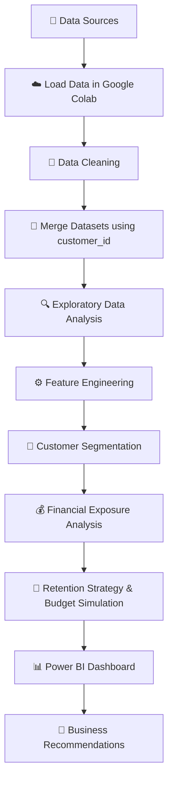

# 📊 Customer Churn Risk & Retention Analysis

  
  
  
  

   
  An end-to-end data analytics project to identify churn risks, understand customer behavior, and develop data-driven retention strategies.

---

## 🧭 Table of Contents

- [📌 Project Overview](#-project-overview)
- [🎯 Business Objectives](#-business-objectives)
- [🛠️ Tools & Technologies](#️-tools--technologies)
- [📂 Repository Contents](#-repository-contents)
- [🔄 Project Workflow](#-project-workflow)
- [🧹 Data Preparation](#-data-preparation)
- [⚙️ Feature Engineering](#️-feature-engineering)
- [🔍 Exploratory Data Analysis](#-exploratory-data-analysis)
- [💡 Key Findings](#-key-findings)
- [💰 Retention Budget Simulation](#-retention-budget-simulation)
- [📈 Power BI Dashboard](#-power-bi-dashboard)
- [🚀 Recommendations](#-recommendations)
- [⚠️ Limitations](#️-limitations)

---

## 📌 Project Overview

Customer churn is a major challenge for businesses because losing customers can affect recurring revenue and long-term customer value.

This project analyzes customer data to identify **high-value customers who are at risk of churning**, investigate patterns behind customer departures, and develop targeted retention strategies.

The analysis is conducted using **Python in Google Colab**, while **Power BI** is used to communicate insights through an interactive dashboard.

### ✨ Project Highlights

| | Highlight | Description |
|:---:|---|---|
| 📊 | **7,043 Records** | Customer dataset used for the analysis |
| 🧩 | **Customer Segmentation** | Classification based on CLTV and churn score |
| 🚨 | **Risk Identification** | Identification of high-value, high-risk customers |
| 💵 | **Financial Analysis** | Estimation of potential CLTV and MRR exposure |
| 🎯 | **Retention Planning** | Customer prioritization and budget simulation |
| 📈 | **Interactive Dashboard** | Visual insights using Power BI |

## 🎯 Business Objectives

- 🔎 Identify high-value customers with elevated churn risk.
- 📉 Analyze churn patterns across contract types and tenure groups.
- 💰 Estimate potential financial exposure using Customer Lifetime Value (CLTV) and Monthly Recurring Revenue (MRR).
- 🧠 Segment customers into actionable retention priority groups.
- 🎯 Develop targeted retention strategies and simulate a retention budget.
- 📊 Present findings in a clear, business-oriented dashboard.

## 🛠️ Tools & Technologies

  
  
  
  

| Technology | Purpose |
|---|---|
| 🐍 Python | Data processing and analysis |
| 🐼 Pandas | Data cleaning, merging, and transformation |
| ☁️ Google Colab | Cloud-based Python notebook environment |
| 📊 Power BI | Interactive dashboard and data visualization |
| 📄 CSV | Source datasets |

## 📂 Repository Contents

| File | Description |
|---|---|
| `Fauzan THT - customer churn risk and retention analysis.pbix` | 📊 Power BI dashboard source file |
| `Fauzan dashboard - THT - customer churn risk and retention analysis.pdf` | 🖼️ Exported dashboard report |
| `Fauzan ppt (THT) - customer_churn_risk_and_retention_analysis.pdf` | 🎤 Project presentation |
| `Fauzan_THT_customer_churn_risk_and_retention_analysis.ipynb` | 🐍 Python analysis notebook for Google Colab |
| `Payment_Info.csv` | 💳 Customer payment information |
| `Service_Options.csv` | 🧰 Customer service and subscription options |
| `Status_Analysis.csv` | 👥 Customer status and churn information |
| `new_status_analysis2 (1).csv` | 📄 Additional dataset included in the project |
| `README.md` | 📘 Project documentation |

## 🔄 Project Workflow

## 🧹 Data Preparation

Three primary datasets were integrated using `customer_id`:

- `Status_Analysis.csv`
- `Payment_Info.csv`
- `Service_Options.csv`

### 📋 Dataset Summary

| Metric | Result |
|---|---:|
| Total records | **7,043** |
| Total columns | **15** |
| Duplicate records identified | **0** |
| Missing `churn_reason` | 5,174 (73.46%) |
| Missing `offer` | 3,877 (55.05%) |

### 🧽 Data Cleaning Steps

- ✔️ Inspected data structure and data types.
- ✔️ Integrated datasets using `customer_id`.
- ✔️ Handled missing values in selected columns.
- ✔️ Checked for duplicate records.
- ✔️ Performed IQR-based outlier checks on selected numerical variables.

### Missing Value Treatment

| Column | Treatment |
|---|---|
| `churn_reason` | Filled with `Not Applicable` |
| `offer` | Filled with `None` |

The IQR-based checks reported no outliers in `cltv`, `churn_score`, `monthly_charges`, and `tenure`.

## ⚙️ Feature Engineering

### 💵 Financial Features

| Feature | Formula | Purpose |
|---|---|---|
| `projected_annual_charges` | `monthly_charges × 12` | Estimate annualized charges |
| `retention_budget_cap` | `cltv × 10%` | Simulate a customer-level retention budget cap |

### 🗓️ Tenure Segmentation

| Segment | Tenure |
|---|---|
| 🆕 New | ≤ 12 months |
| 🌱 Mid-term | > 12 to 24 months |
| 🌿 Established | > 24 to 48 months |
| ⭐ Loyal | > 48 months |

### 🎯 Customer Priority Matrix

The customer segmentation uses the median values of CLTV and churn score:

- **Median CLTV:** `$4,527`
- **Median Churn Score:** `61`

Values equal to or above the median are classified as High; values below the median are classified as Low.

| Priority | Segment | Recommended Focus |
|:---:|---|---|
| 🔴 **P1** | High Value – High Risk | Immediate, targeted retention |
| 🟢 **P2** | High Value – Low Risk | Loyalty and relationship building |
| 🟠 **P3** | Low Value – High Risk | Cost-effective retention |
| ⚪ **P4** | Low Value – Low Risk | Routine monitoring |

## 🔍 Exploratory Data Analysis

The analysis explores customer behavior and potential churn drivers through:

- 📉 Churn distribution and reported churn reasons.
- 📄 Contract type and churn rate.
- 🗓️ Tenure and churn behavior.
- 💎 CLTV and churn score segmentation.
- 😊 Customer satisfaction across service groups.
- 💰 Monthly recurring revenue and potential financial exposure.

## 💡 Key Findings

### 🚨 1. High-Value, High-Risk Customers

The Priority 1 segment contains **1,667 customers**.

| Customer Status | Customers | Percentage |
|---|---:|---:|
| 🟢 Stayed | 839 | 50.33% |
| 🔴 Churned | 790 | 47.39% |
| 🆕 Joined | 38 | 2.28% |
| **Total** | **1,667** | **100%** |

For the active retention analysis, customers were filtered to `customer_status = Stayed`, resulting in **839 active Priority 1 customers**.

### 💰 2. Potential Financial Exposure

| Metric | Value |
|---|---:|
| 💎 CLTV at Risk | **$4,567,572** |
| 💵 MRR at Risk | **$55,498.65/month** |
| 📊 Average CLTV per Active Priority 1 Customer | $5,444.07 |
| 💳 Average MRR per Active Priority 1 Customer | $66.15/month |

> ⚠️ These figures represent potential financial exposure associated with the analyzed segment, not guaranteed future losses.

### 📄 3. Churn by Contract Type

Within the Priority 1 segment, month-to-month customers have the highest observed churn rate.

| Contract Type | Customers | Churned | Churn Rate |
|---|---:|---:|---:|
| Month-to-Month | 923 | 663 | **71.83%** |
| One Year | 329 | 89 | 27.05% |
| Two Year | 415 | 38 | 9.16% |

**Insight:** Month-to-month customers are a key group to consider for targeted retention initiatives and carefully tested annual contract offers.

### 🗓️ 4. Churn by Tenure

| Tenure Group | Churn Rate |
|---|---:|
| ≤ 1 year | **47.4%** |
| > 1–2 years | 28.7% |
| > 2–4 years | 20.4% |
| > 4 years | 9.5% |

**Insight:** Customers with shorter tenure have higher observed churn rates, highlighting the importance of early engagement and onboarding.

### 😊 5. Customer Satisfaction

Among high-value customers with tenure of 12 months or less:

| Internet Service | Average Satisfaction |
|---|---:|
| Yes | 2.66 |
| No | 3.61 |

**Insight:** The satisfaction gap is worth investigating further to understand the experience of newer, high-value customers.

### 🗣️ 6. Reported Churn Reasons

| Churn Category | Customers |
|---|---:|
| 🏁 Competitor | 841 |
| 🤝 Attitude | 314 |
| 😕 Dissatisfaction | 303 |
| 💲 Price | 211 |
| 📌 Other | 200 |

Competitor-related reasons represent the largest category in the analyzed data.

## 💰 Retention Budget Simulation

The budget simulation focuses on **839 active Priority 1 customers**, using a budget cap equivalent to 10% of CLTV.

### 💵 Budget Overview

| Budget Metric | Value |
|---|---:|
| Target Customers | **839** |
| Total Budget Cap | **$456,757.20** |
| Average Budget Cap per Customer | **$544.41** |
| Budget Assumption | 10% of CLTV |

### 🧩 Proposed Strategy Allocation

| Retention Strategy | Customers | Allocation |
|---|---:|---:|
| 💚 Loyalty Programs and Regular Monitoring | 614 | 73.18% |
| 📄 Annual Contract Offers with Measured Incentives | 225 | 26.82% |

The proposed allocation provides a starting point for targeted retention activities. Actual spending should be validated against program costs and measured retention outcomes.

## 📈 Power BI Dashboard

The Power BI dashboard translates the analytical results into business-friendly visual insights.

### Dashboard Deliverables

- 📊 **Power BI Report (`.pbix`)** — editable dashboard source.
- 🖼️ **Dashboard PDF** — exported report for convenient viewing.
- 🎤 **Project Presentation (`.pdf`)** — summary of the analysis and recommendations.
- ☁️ **Google Colab Notebook (`.ipynb`)** — data preparation, analysis, and feature engineering.

## 🚀 Recommendations

Based on the findings, the following actions are proposed:

1. 🔴 **Prioritize high-value, high-risk customers.** Focus retention resources on active customers with high CLTV and high churn scores.
2. 🌱 **Strengthen early customer engagement.** Improve onboarding and follow-up for customers in their first year.
3. 📄 **Review month-to-month contracts.** Test annual contract offers with carefully measured incentives.
4. 😊 **Investigate satisfaction gaps.** Explore service experience differences among newer, high-value customers.
5. 🧪 **Launch a retention pilot.** Test the proposed strategies on a defined customer group before scaling.
6. 📏 **Measure business outcomes.** Track retention rate, cost per retained customer, and protected margin.

## ⚠️ Limitations

- 📌 The analysis is descriptive and does not establish causal relationships.
- 💰 Financial exposure metrics represent potential risk, not guaranteed losses.
- 🧮 The 10% CLTV retention budget is a simulation assumption, not a validated optimal budget.
- 🧪 Retention strategies should be tested and evaluated using actual business outcomes before broader implementation.

---
